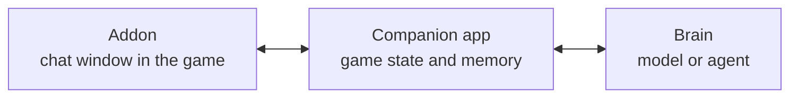

# Familiar

An AI companion for World of Warcraft, starting with WoW Forever. Bring your own brain.

> [!NOTE]
> Familiar is in pre-alpha. There is nothing to install yet.

Familiar adds a second chat window to the game. Ask about your gear, talents, quests or the next boss, and the answer comes back with real item, spell and quest links. Familiar reads your character from the game, so you never have to describe your gear.

You pick the AI behind it:

- your ChatGPT plan, through Sign in with ChatGPT
- an API key from OpenAI, Anthropic, Google AI Studio or OpenRouter
- a local model in Ollama or LM Studio
- an agent you already use, such as Hermes, OpenClaw, Gemini CLI, Codex or Pi

The memory belongs to Familiar, not to the model, so switching models does not reset it.

## How it works

The addon shows the chat and reads your character. The companion app on your PC passes messages along and offers the game state and the memory as tools through the Model Context Protocol (MCP). The brain is either a model behind Familiar's built-in agent or an agent you already use, connected through the Agent Client Protocol (ACP).

Familiar only advises. It never moves, casts or targets for you. The design is described in [ADR 0001](docs/adr/0001-architecture-addon-companion-and-brains.md).

## Roadmap

| Phase                     | Goal                                                                   | Status                                  |
| ------------------------- | ---------------------------------------------------------------------- | --------------------------------------- |
| 0 Foundation              | repository, tooling and the first architecture decisions               | done                                    |
| 1 Walking skeleton        | a question typed in the game reaches a brain and the answer comes back | in progress: transport built (ADR 0005) |
| 2 Game context and links  | the full character as context, links in both directions                |                                         |
| 3 Brains                  | built-in agent for API keys and local models, any agent through ACP    |                                         |
| 4 Memory                  | a memory that survives a change of brain                               |                                         |
| 5 Desktop app and release | installers and updates for Windows, macOS and Linux                    |                                         |
| 6 Public alpha            | release on CurseForge, website and user docs                           |                                         |

## Repository

| Folder            | Contents                                 |
| ----------------- | ---------------------------------------- |
| [`addon/`](addon) | WoW addon (Lua)                          |
| [`core/`](core)   | companion core (TypeScript, Bun)         |
| [`app/`](app)     | desktop app (Tauri, Svelte)              |
| [`docs/`](docs)   | architecture decisions and documentation |

## Contributing

See [CONTRIBUTING.md](CONTRIBUTING.md). AI agents start with [AGENTS.md](AGENTS.md). Please report security problems privately as described in [SECURITY.md](SECURITY.md).

## License

[MIT](LICENSE). Familiar is not affiliated with or endorsed by Blizzard Entertainment. World of Warcraft is a trademark of Blizzard Entertainment, Inc.
